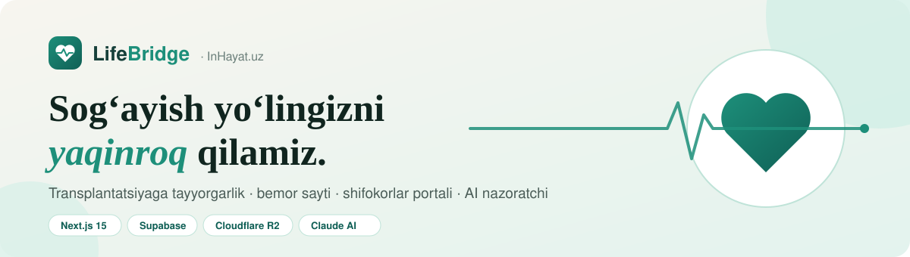
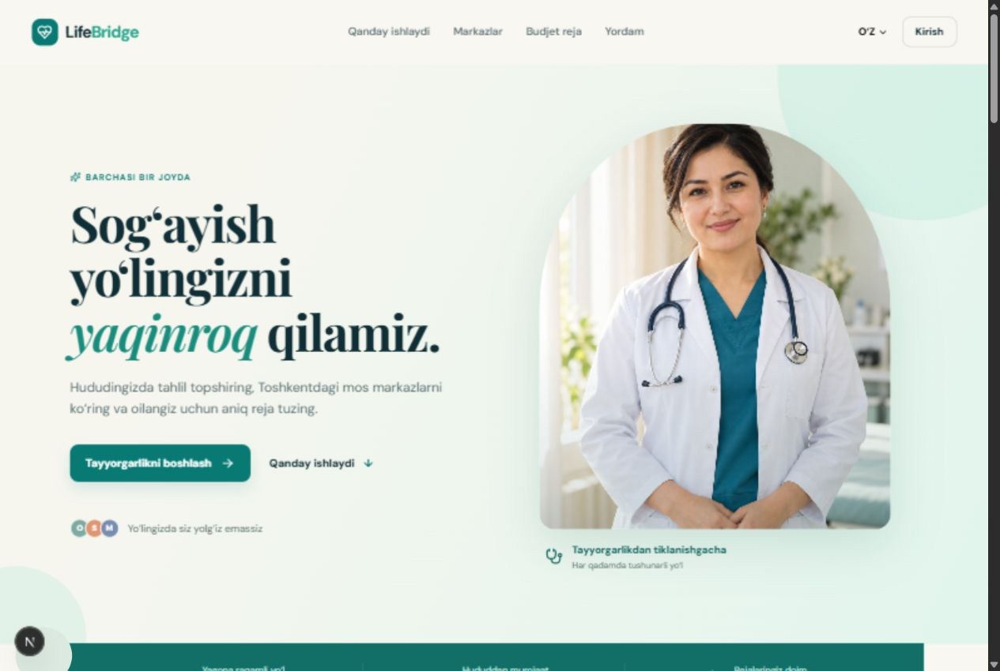
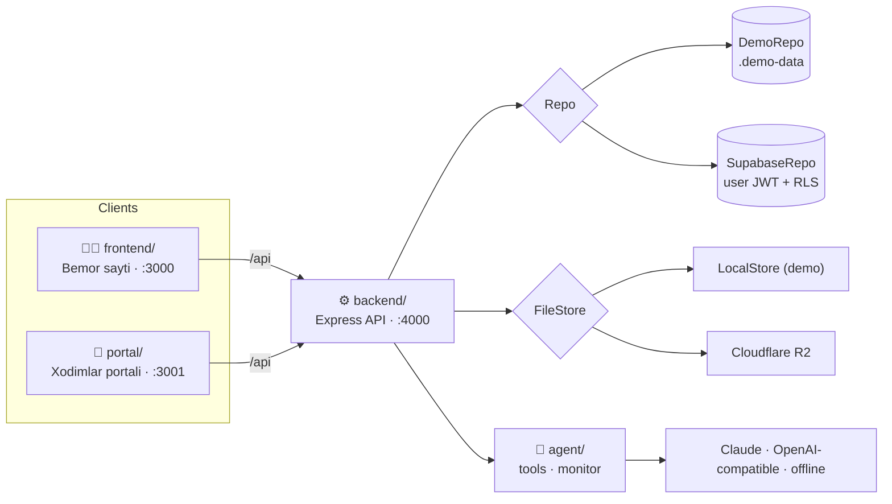

<p align="center">
  
</p>

<p align="center">
  <a href="https://www.inhayat.uz"></a>
  
  
  
  
  
</p>

<p align="center">
  <b>O‘zbekiston bo‘ylab transplantatsiyadan oldingi tayyorgarlikni muvofiqlashtiruvchi platforma.</b><br/>
  Bemor sayti · Shifokorlar portali · API · AI monitoring agenti — bitta tizimda.
</p>

<p align="center">
  <a href="#-imkoniyatlar">Imkoniyatlar</a> •
  <a href="#-demo--3-buyruq">Demo</a> •
  <a href="#-arxitektura">Arxitektura</a> •
  <a href="#-ai-agent-nazoratchi">AI agent</a> •
  <a href="#-production">Production</a>
</p>

---

<p align="center">
  
</p>

## ✨ Imkoniyatlar

<table>
<tr>
<td width="50%" valign="top">

### 🧑‍⚕️ Bemor sayti
- Shaxsiy kabinet: telefon + parol (Supabase Auth)
- Tayyorgarlik bo‘yicha qadam-baqadam checklist
- Tibbiy hujjatlarni xavfsiz yuklash (R2, presigned URL)
- Toshkentdagi markazlarni xaritada ko‘rish va solishtirish
- Oilaviy budjet rejasi
- Tasdiqlangan shifokor bilan ulashish va yozishma
- 🇺🇿 / 🇷🇺 / 🇬🇧 tillar

</td>
<td width="50%" valign="top">

### 🏥 Xodimlar portali
- Shifokor ish joyi: bemor murojaatlari, hujjatlar, chat
- Admin boshqaruv paneli: statistika, ogohlantirishlar, faoliyat
- Xodimlar arizalarini ko‘rib chiqish (tasdiqlash / rad etish)
- **AI Nazoratchi** konsoli — chat orqali platformani boshqarish
- Har bir amal audit jurnaliga yoziladi
- Rol asosidagi kirish + Supabase RLS

</td>
</tr>
</table>

## 🚀 Demo — 3 buyruq

> Supabase kerak emas — kalitlar bo‘sh bo‘lsa, backend **demo rejim**da ishlaydi.

```bash
npm run setup      # barcha paketlarni o‘rnatadi
npm run dev        # backend + bemorlar sayti + portal birga
```

| Sayt | Manzil | Demo hisob |
|---|---|---|
| Bemorlar sayti | http://localhost:3000/cabinet | “Demo bemor sifatida kirish” tugmasi (`+998901234567` / `Demo12345`) |
| Shifokorlar portali | http://localhost:3001 | `doktor@demo.inhayat.uz` / `Demo123456` |
| Platforma admini | http://localhost:3001 | `admin@demo.inhayat.uz` / `Demo123456` |
| Tekshiruvdagi xodim | http://localhost:3001 | `yangi@demo.inhayat.uz` / `Demo123456` |

Portal kirish sahifasida demo hisoblar bir bosishda kirish tugmalari bilan chiqadi.

Demo ma’lumotlar `backend/.demo-data/` papkasida saqlanadi (bazasi `db.json`, fayllar `files/` ichida). Unda tayyor bemorlar, shifokorlar, hujjatlar va yozishmalar bor. Bemorlar sayti va portal bitta API'dan foydalanadi, shuning uchun bemor ruxsat bersa, shifokor uni portalda darhol ko‘radi. Demoni boshlang‘ich holatga qaytarish uchun admin panelidagi tugmani bosing yoki `npm run demo:reset` buyrug‘ini ishga tushiring.

> [!WARNING]
> Demo rejimda haqiqiy tibbiy ma’lumot kiritmang. Sayt bu haqda ogohlantirib turadi.

**Haqiqiy bazaga o‘tish:** `backend/.env`, `frontend/.env.local` va `portal/.env.local` fayllariga Supabase URL va anon key'ni yozing. Supabase'da `backend/supabase/` papkasidagi SQL fayllarni 001 dan 005 gacha tartib bilan ishga tushiring. Shundan keyin kodni o‘zgartirmasdan haqiqiy bazaga o‘tiladi. R2 kalitlari qo‘shilsa, fayllar Cloudflare R2'ga saqlana boshlaydi. Batafsil: [PORTAL.md](./PORTAL.md), [SETUP.md](./SETUP.md).

## 🧭 Arxitektura



| Papka | Vazifasi |
|---|---|
| `frontend/` | Bemor sayti (Next.js). Barcha ma’lumot backend API orqali o‘tadi; Supabase faqat kirish uchun ishlatiladi. |
| `portal/` | Xodimlar portali: shifokor ish joyi, admin paneli, xodimlarni ko‘rib chiqish, AI agent konsoli. |
| `backend/src/app.ts` | Barcha route'lar · `repo/` — ma’lumotlar qatlami (demo + Supabase) · `agent/` — AI agent · `storage.ts` — fayllar. |
| `backend/supabase/` | Sxema va 001–005 migratsiyalar (RLS siyosatlari, admin funksiyalari, agent auditi). |

**Testlar:** `npm test` — frontend unit testlari + backend end-to-end API testlari (bemor → shifokor → admin → agent).

`frontend/.env.example` → `frontend/.env.local`, `backend/.env.example` → `backend/.env` ga nusxalang. R2 kalitlarini faqat backend muhitida saqlang.

## 🤖 AI agent “Nazoratchi”

Platforma adminlari uchun chat ko‘rinishidagi AI yordamchi. U javobsiz qolgan bemorlarni, kutib qolgan arizalarni va harakatsiz murojaatlarni topadi, statistika beradi va tizim holatini tekshiradi.

- 🔐 Faqat **admin** hisobi bilan ishlaydi va faqat metama’lumotni ko‘radi (tibbiy hujjatlar unga berilmaydi)
- ✅ Ma’lumotni o‘zgartiradigan har bir amal **admin tasdig‘i**ni talab qiladi (bir martalik, 15 daqiqa amal qiladi)
- 📜 Har bir tool chaqiruvi audit jurnaliga yoziladi
- 🔌 Claude, istalgan OpenAI-mos API yoki kalitsiz **oflayn rejim**

Batafsil, tool qo‘shish yo‘riqnomasi bilan: **[AGENT.md](./AGENT.md)**

## ☁️ Production

| Qatlam | Xizmat |
|---|---|
| UI va API route'lar | **Vercel** |
| Bemor profillari, klinik natijalar metama’lumoti, markazlar, navbat holati | **Supabase** |
| Shifrlangan asl tibbiy hujjatlar va rasmlar | **Cloudflare R2** (Supabase'da faqat obyekt kaliti va metama’lumot) |

Frontend va backend alohida deploy qilinadi. Frontend'da `BACKEND_INTERNAL_URL` backend manziliga, backend'da `FRONTEND_ORIGIN` aniq frontend manziliga o‘rnatiladi.

<details>
<summary><b>Birinchi production sozlash</b></summary>

1. Supabase loyihasini yarating va SQL Editor'da [`backend/supabase/schema.sql`](./backend/supabase/schema.sql) ni ishga tushiring.
2. Supabase Auth → Phone provider'ni yoqing, SMS provayderni sozlang, production sayt URL'i va `/cabinet` redirect URL'ini kiriting.
3. Yopiq (private) Cloudflare R2 bucket yarating; CORS'ni faqat Vercel production domeni uchun sozlang, tibbiy fayllarni ommaviy qilmang.
4. `.env.example` dagi barcha qiymatlarni Vercel Environment Variables'ga qo‘shing, so‘ng GitHub'dan deploy qiling yoki `vercel --prod` ni ishga tushiring.

`/api/documents/upload` route'i besh daqiqalik R2 presigned yuklash URL'ini faqat Supabase autentifikatsiyasidan keyin yaratadi. Brauzer yuklashni tugatgach, klient `medical_documents` jadvaliga faqat R2 obyekt kaliti va metama’lumotni saqlaydi.

</details>

<details>
<summary><b>Kabinet oqimi</b></summary>

`/cabinet` — haqiqiy Supabase sessiya oqimi: telefon raqami + parol (Supabase'da ichki `user_<digits>@inhayat.internal` login sifatida saqlanadi; “Confirm email” o‘chirilgan bo‘lishi kerak, qarang: PORTAL.md) → shaxsiy murojaat → R2'ga hujjat yuklash → tasdiqlangan shifokor bilan ixtiyoriy ulashish. Muhit o‘zgaruvchilari bo‘lmasa, u ataylab sozlash ekranini ko‘rsatadi; brauzerning o‘zida ishlaydigan zaxira hisob rejimi yo‘q.

</details>

## 🛠 Texnologiyalar

<p>
  
</p>

## 📚 Hujjatlar

| Fayl | Mazmuni |
|---|---|
| [SETUP.md](./SETUP.md) | O‘rnatish va muhit o‘zgaruvchilari |
| [PORTAL.md](./PORTAL.md) | Xodimlar portali va Supabase sozlamalari |
| [AGENT.md](./AGENT.md) | AI agent, toollar, xavfsizlik qoidalari |
| [MVP-RELEASE.md](./MVP-RELEASE.md) | MVP reliz eslatmalari |

---

> [!IMPORTANT]
> Bu interfeys rejalashtirish vositasi. Muvofiqlik, kutish ro‘yxatidagi o‘rin va davolash qarorlari litsenziyaga ega shifokorlar va tegishli tibbiyot markazi tomonidan tasdiqlanishi kerak.

<p align="center">
  Muallif: <a href="https://github.com/Karimov10112"><b>Azamatjon Karimov</b></a> · <a href="https://www.inhayat.uz">inhayat.uz</a>
</p>
